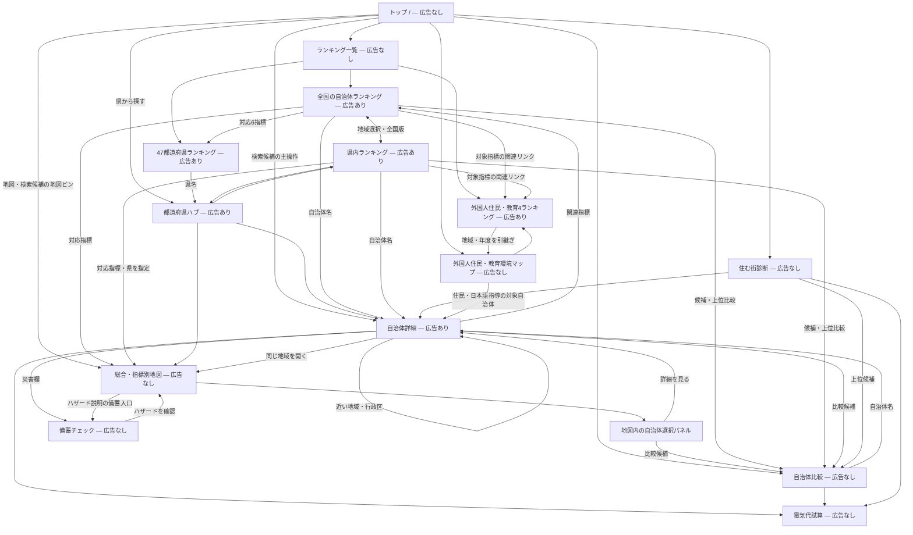
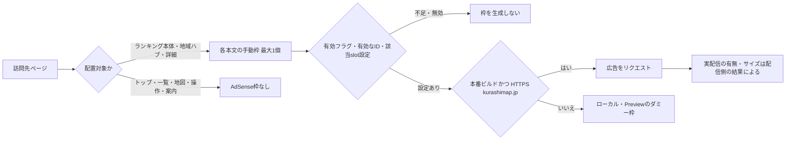

# ページ一覧・導線・広告配置の現状

確認日：2026-11-26。参照コード：`origin/main` の `d3f8cc4`（PR #279マージ後）。

現在のAdSense配置は、**ランキング本体・都道府県ハブ・自治体詳細**に限られる。トップ、ランキング一覧、地図、比較、診断、電気代、備蓄、検索、サイト案内には配置していない。これは現行の配置方針であり、未配置ページをすべて追加予定として扱うものではない。

本資料はコードによる棚卸し。広告枠の存在と実際の広告配信を区別する。本番の配信率・収益・管理画面設定の再確認は今回の対象外。#280（福岡の配置変更）と#281（兵庫SEO）は未マージのため、現状図には含めない。

## 1. ページ一覧

「広告あり」は有効なAdSense設定の下で枠を生成する実装があることを示す。アフィリエイトや支援リンクは第5節に分ける。`{pref}` は都道府県slug、`{code}` は5桁の自治体コード、`{metric}` は指標slug。

| 分類 | URL | 役割・内容 | 主な流入元 → 次の行動 | AdSense |
|---|---|---|---|---|
| トップ | `/` | 自治体・駅検索、都道府県選択、地図・ランキングへの入口 | 共通ロゴ・検索流入 → 地域ハブ、自治体詳細、地図、ランキング、比較、診断 | なし |
| 総合地図 | `/map` | 全画面地図。指標切替、ハザード重ね合わせ、地域検索 | トップ・各閲覧ページ → 自治体選択パネル、詳細、比較候補 | なし |
| 指標別地図 | `/map/{theme}` | 8種類。地図と説明・関連リンクのドロワー | トップ・フッター・関連ランキング → 地図内の地域選択、関連ランキング、詳細 | なし |
| 外国人住民・教育環境マップ | `/map/foreign-resident-issues` | 年度・地域・テーマを切り替える独立した統計画面 | トップ・フッター・専用ランキング → 推移・関連統計、対象自治体の詳細、専用ランキング | なし |
| ランキング一覧 | `/ranking` | 通常24指標、都道府県比較6指標、外国人住民・教育4指標の入口 | トップ・共通ナビ・各ページ → 各ランキング本体 | **なし** |
| 全国の自治体ランキング | `/ranking/{metric}` | 通常24指標。全国は原則上位100件、検索は全有効自治体を対象 | 検索・ランキング一覧・地域ページ → 自治体詳細、比較、県内版、関連地図、診断 | あり・最大1枠 |
| 県内の自治体ランキング | `/ranking/{metric}/{pref}` | 県内の有効自治体を比較。24指標×47県のルート | 検索・全国版・地域ハブ → 自治体詳細、比較、全国版、地域ハブ、関連地図、診断 | あり・最大1枠 |
| 都道府県ランキング | `/ranking/{metric}/prefecture` | 6指標で47都道府県を比較 | ランキング一覧・全国版・県ハブ → 都道府県ハブ、全国の自治体版、別の県比較、診断 | あり・1枠 |
| 外国人住民・教育ランキング | 第2節の4URL | 外国人住民の前年比増加数・率、学校の外国籍割合 | 検索・ランキング一覧・専用マップ・対象の通常ランキング内リンク → **専用マップの該当地域・年度** | 条件付き・最大1枠 |
| 都道府県ハブ | `/area/{pref}` | 47県。データ概況、県内自治体、各指標への入口 | トップの県選択・都道府県ランキング・パンくず → 自治体詳細、県内ランキング、地図、診断 | **あり・1枠** |
| 自治体詳細 | `/area/{pref}/{code}` | 1,918市区町村・行政区の住環境、比較データ、近い地域、FAQ | 検索・ランキング・県ハブ・地図・比較・診断 → 他の自治体、比較、地図、ランキング、電気代、備蓄 | あり・1枠 |
| 自治体比較 | `/compare` | 最大3自治体のデータ比較 | ランキング・地図・詳細の比較候補、診断 → 自治体詳細、電気代試算 | なし |
| 住む街診断 | `/shindan` | 重視条件に合う候補を提示 | トップ・共通ヘッダー・ランキング・県ハブ → 結果の詳細、上位候補の比較、電気代試算 | なし |
| 電気代シミュレーション | `/denki` | エリア・使用量・人数などから試算 | 詳細内の簡易試算・比較・診断・共通ナビ → プランの外部サイト、総合地図 | なし |
| 家庭の備蓄チェック | `/bousai/stockpile` | 人数・日数・備蓄状況を入力 | 詳細の災害欄・ハザードマップ・フッター → ハザードマップ、公式資料 | なし |
| 検索結果 | `/search?q=…` | 市区町村名の検索結果。`noindex,follow` | 直接アクセス・WebSiteのSearchAction → 自治体詳細、ランキング、地図 | なし |
| サイト案内 | `/about` | データ出典、算出方法、更新方針 | ヘッダー・フッター・算出方法リンク → 地図、ランキング、プライバシー | なし |
| プライバシー | `/privacy` | 外部送信、広告、アンケートなどの説明 | フッター・関連説明リンク → サイト案内、地図、外部ポリシー | なし |
| 404・エラー | 存在しないURLなど | 例外時の案内。通常の集客ページではない | 不正なURL・読み込み失敗 → 復帰操作 | なし |

通常の `app/**/page.tsx` は28定義。動的ルートのため定義数と公開URL数は一致しない。市区町村・行政区を含む詳細の1,918件と、政令市の行政区を重複集計しないランキング・比較の対象数も一致しない。県内ランキングは該当データのある組み合わせを生成する（11/26検証ビルドでは1,128URL）。クエリやアンカー違いは独立ページとして数えない。

## 2. 地図・ランキングの内訳

### 地図：総合1＋指標別8＋独立画面1

| URL | 内容 | 説明・関連リンクからの主な遷移 |
|---|---|---|
| `/map` | 総合 | 地域ハブ、自治体詳細、ランキング、他の地図 |
| `/map/rent` | 家賃相場 | 家賃の高い・安いランキング、県内版、自治体詳細 |
| `/map/land-price` | 地価 | 地価の高い・安いランキング、県内版、自治体詳細 |
| `/map/population-trend` | 人口増減 | 人口増加率・人口規模ランキング、人口増加率の県内版、自治体詳細 |
| `/map/future-population` | 2050年の将来人口 | 将来人口の減少・維持ランキング、県内版、自治体詳細 |
| `/map/vacancy` | 空き家率 | 空き家率の高い・低いランキング、県内版、自治体詳細 |
| `/map/aging` | 高齢化率 | 高齢化率の高い・低いランキング、県内版、自治体詳細 |
| `/map/hazard` | ハザード・避難先 | 県ハブ、詳細の災害欄 `#hazard`、備蓄チェック |
| `/map/foreign-ratio` | 既存の外国人住民比率 | 既存比率ランキング、県内版、自治体詳細 |
| `/map/foreign-resident-issues` | 外国人住民・教育環境の時系列 | 専用4ランキング、自治体詳細、既存比率マップ |

最後の独立画面だけは `PageShell` による通常のヘッダー・フッターを持つ。それ以外の地図9ページは全画面の `HomeShell` と地図内メニューを使い、通常ページの共通ヘッダー・フッターを表示しない。メニューから説明とリンク帯を開く。

### 通常ランキング：24指標

各slugに全国版 `/ranking/{metric}` と県内版 `/ranking/{metric}/{pref}` がある。

| 分野 | 指標slug |
|---|---|
| 家賃 | `rent-cheap`、`rent-high` |
| 空き家 | `vacancy-high`、`vacancy-low` |
| 地価 | `land-price-high`、`land-price-low` |
| 保育 | `waitlist-zero`、`childcare-capacity` |
| 交通・生活施設 | `stations`、`medical-facilities`、`preschools` |
| 人口規模・密度 | `population-most`、`population-density`、`population-density-low` |
| 人口増減 | `population-growth`、`population-decline` |
| 高齢化 | `aging-high`、`aging-low` |
| 財政 | `fiscal-strong`、`fiscal-weak` |
| 将来人口 | `future-population-decline`、`future-population-resilient` |
| 既存の外国人住民比率 | `foreign-ratio-high`、`foreign-ratio-low` |

`waitlist-zero` は条件に該当する自治体の一覧で、優劣をつける順位表ではない。地方別は `/ranking/{metric}?region=kanto` のような同じページの絞り込み状態で、別のパスを持たない。県を選ぶと県内版へ移動する。

### 都道府県比較：6指標

`/ranking/{metric}/prefecture` があるのは `population-most`、`population-density`、`aging-high`、`vacancy-high`、`foreign-ratio-high`、`childcare-capacity`。これは「福岡県内の市町村を並べる県内版」とは別で、47都道府県そのものを並べるページ。

### 外国人住民・教育ランキング：4ページ

| URL | 地域の単位 | 地域名を押した先 |
|---|---|---|
| `/ranking/foreign-resident-growth` | 市区町村 | 専用マップの住民テーマ・該当自治体・基準年・増加数 |
| `/ranking/foreign-resident-growth-rate` | 市区町村 | 専用マップの住民テーマ・該当自治体・基準年・増加率 |
| `/ranking/foreign-student-elementary-ratio` | 都道府県 | 専用マップの教育テーマ・該当県・基準年度・小学校 |
| `/ranking/foreign-student-junior-ratio` | 都道府県 | 専用マップの教育テーマ・該当県・基準年度・中学校 |

この4ページに通常24指標の県内版や `/prefecture` 版はない。通常ランキングの行名は自治体詳細へ進むが、この4ページの行名は専用マップへ進む。統計の対象・基準日が異なるため、既存の `foreign-ratio-high/low` と一つにまとめない。

## 3. サイト全体の主な導線

図は本文の主な導線を示す。全ページへ共通ナビから移動できることを示す図ではなく、主要な実装リンク・操作に絞っている。外部検索からはトップを経由せず、ランキング・詳細・地図へ直接着地できる。

### 共通ナビと例外

| 場所 | 主なリンク | 注意点 |
|---|---|---|
| 通常ページのヘッダー | トップ、総合地図、ランキング一覧、比較、診断、電気代、サイト案内 | スマートフォンでは電気代・サイト案内を非表示。フッターからは移動可能 |
| 通常ページのフッター | 総合地図＋指標別・独立マップ9件、ランキング、比較、診断、電気代、備蓄、サイト案内、プライバシー | `SiteFooter` の共通リンク。AdSenseのCMPが利用可能なら設定リンクも表示 |
| 全画面地図のメニュー | 総合地図は `HomeLinks`、指標別は説明・関連ランキング・県別リンクなど | 地図上の自治体検索はパネルを開く。トップの検索候補とは主操作が異なる |
| パンくず・戻りリンク | トップ、ランキング一覧、全国版、県ハブなど | 地域・ランキング階層へ戻る導線。詳細内のセクションナビは別ページではなくアンカー移動 |
| `/search` | 検索フォーム、自治体詳細、ランキング、地図 | トップの候補検索は通常このページを経由しない |

### 代表的な利用経路

| 意図 | 実装されている経路の例 |
|---|---|
| 人口の多い街を探す | 検索 → 福岡の人口ランキング → 自治体詳細 → 比較候補へ追加 → 最大3自治体を比較 |
| 県から調べる | トップ → 福岡県ハブ → 県内の家賃ランキング → 自治体詳細 → 地図で周辺を見る |
| 地図を起点にする | トップ → 総合地図 → 地域クリック／検索 → パネル → 詳細を見る |
| 条件から候補を作る | トップ／ランキング → 診断 → 上位候補を比較 → 自治体詳細 → 電気代試算 |
| 新しい外国人住民統計を調べる | 専用増加率ランキング → 地域名 → 専用マップで年度推移 → 自治体の住環境詳細 |
| 防災の備えを確認する | 詳細の災害欄／ハザードマップ → 簡易備蓄入力 → 備蓄チェック → ハザードマップ |

これらはコード上可能な経路であり、実際の利用割合・離脱箇所を示すものではない。利用頻度を判断する際はGA4のページ遷移・比較開始・ツール入口などの実績を別途確認する。

## 4. AdSenseの配置箇所と表示条件

| ページ群 | 枠の位置 | 条件・例外 | 実装 |
|---|---|---|---|
| 全国・県内の通常ランキング | 先頭10件・比較リンクの後、11件目以降を開く操作の前。広いPCでは同じ1枠を横に配置 | 元の `rows` が1件以上なら配置。検索結果が0件でも元データがあれば枠は残る | `RankingExplorer` |
| 47都道府県ランキング | 全順位表の後、別指標のリンク群の前 | 1枠 | `app/ranking/[metric]/prefecture/page.tsx` |
| 外国人住民・教育4ランキング | 上位10件の後。PCでは上位表の横、続きの表はその後 | 有効な値が10件以上。非空検索を一度行うと枠を外し、その文書内では検索を消しても復活させない | `ForeignRankingTable` |
| 都道府県ハブ | データ概況の後 | 1枠 | `app/area/[pref]/page.tsx` |
| 自治体詳細 | 「データで見る」の相対比較説明の後。説明がない場合は詳細データの後 | 条件が排他的なので合計1枠 | `app/area/[pref]/[city]/page.tsx` |

共通レイアウトに全ページ向けの広告枠や配信ローダーはない。`google-adsense-account` の確認メタタグがあっても、そのページに広告枠があることは意味しない。実配信には `enabled`、公開ID、該当する `ranking`／`area` のslot、Production判定、host・protocolがそろう必要がある。枠があっても必ず広告が配信されるとは限らない。

広告対象への出入り・広告対象間のリンクでは、CSPとスクリプトを切り替えるため文書全体を読み直す。アンカーや比較候補への追加はこのページ遷移と区別される。既存方針は自動広告・全画面・追従・自動最適化を有効化せず、手動枠で管理するもの。管理画面の設定値そのものはコードだけでは確認できない。

## 5. AdSense以外の収益・支援導線

「AdSenseなし」は、外部の収益リンクも一切ないという意味ではない。以下は環境設定や対象データの条件で表示される。

| 導線 | 配置される場所 | 遷移先・条件 |
|---|---|---|
| 火災保険 | 地図の自治体パネル、自治体詳細の災害欄、県ハブのハザード欄、ハザードマップの説明、診断の災害条件に応じた結果欄 | 設定された外部リンク。未設定なら非表示 |
| ふるさと納税 | 対応する通常ランキング、自治体詳細の将来人口欄 | 対応自治体・指標・環境設定に依存。全ランキングにあるわけではない |
| 電気プラン | `/denki` のプラン比較 | アフィリエイト設定があればそのURL、なければ公式URLへの案内 |
| サイト支援 | 自治体詳細の支援案内 | 支援先URLが設定された場合のみ表示 |

詳細からの「電気代を詳しく試算」「備蓄をチェック」はまずサイト内ツールへの導線であり、そのリンク自体をAdSense広告枠と数えない。

## 6. URLの状態とページ以外の経路

| 種類 | 例 | 数え方・役割 |
|---|---|---|
| 地図の選択状態 | `/map?code=40220`、`/map/rent?pref=fukuoka` | 同じ地図ページ。自治体・県を初期選択 |
| ランキングの地方選択 | `/ranking/population-most?region=kanto` | 全国版の絞り込み状態。県内版の独立パスとは区別 |
| 比較候補・流入元 | `/compare?codes=40220,40221&from=ranking` | 同じ比較ページ。候補・計測用の状態を引継ぎ |
| 診断・試算・備蓄の状態 | `/shindan?from=home`、`/denki?code=40220&from=area_detail`、`/bousai/stockpile?from=area&quick=1` | 同じツール。簡易入力の一部は保存状態から引継ぐ |
| 専用マップの状態 | `/map/foreign-resident-issues?tab=education&stage=junior&code=40` など | 同じ独立画面。テーマ・年度・地域・指標を引継ぎ |
| ページ内アンカー | 自治体詳細の `#hazard`、`/about#score` | ページ内の説明へ移動。独立ページではない |
| API | `/api/muni/{code}`、`/api/shelters/{code}`、`/api/station-search`、`/api/town-search`、`/api/content-feedback` | 画面から利用するデータ・送信経路。集客・広告ページではない。アンケートは停止中 |
| OGP画像 | `/api/og`、`/api/og/{code}`、`/api/og/pref/{slug}`、`/api/og/ranking/{metric}` | 共有用の画像応答 |
| 運用・配信ファイル | `/sitemap.xml`、`/robots.txt`、`/ads.txt`、各種公開データJSON | 検索・広告・画面のためのファイル。閲覧ページ一覧とは区別 |

`app/sitemap.ts` は検索向けのURL一覧であり、画面間の導線一覧ではない。検索結果の `/search` は除外される一方、操作ツールのベースURLは含まれる。ナビの文言や「内部送客用」という目的だけから `noindex` と判断しない。

## 7. 根拠と更新方法

| 確認内容 | 主なコード・既存資料 |
|---|---|
| ルートと検索向けURL | `app/**/page.tsx`、[sitemap](../../app/sitemap.ts)、[robots](../../app/robots.ts) |
| 共通導線 | [ヘッダー](../../components/SiteHeader.tsx)、[フッター](../../components/SiteFooter.tsx)、[地図・ツールURL定義](../../lib/siteNav.ts) |
| トップと検索 | [トップ](../../app/page.tsx)、[検索候補](../../components/home/HeroSearch.tsx)、[HomeLinks](../../components/HomeLinks.tsx)、[県選択](../../components/home/PrefRegionPicker.tsx) |
| 地図 | [HomeShell](../../components/HomeShell.tsx)、[地図本体](../../components/MapView.tsx)、[指標ハブ](../../components/MetricMapHub.tsx)、[地域指定URL](../../lib/mapDeepLink.ts) |
| ランキング | [通常指標](../../lib/rankings.ts)、[都道府県指標](../../lib/prefRankings.ts)、[通常順位表](../../components/ranking/RankingExplorer.tsx)、[地域切替](../../lib/rankingScope.ts) |
| 専用ランキング | [4指標と遷移先生成](../../lib/foreignRankings.ts)、[専用順位表](../../components/foreign-resident-issues/ForeignRankingTable.tsx)、[専用マップ画面](../../app/map/foreign-resident-issues/page.tsx) |
| 広告条件 | [DisplayAd](../../components/monetization/DisplayAd.tsx)、[配信・対象URL判定](../../lib/adsensePolicy.mjs)、[導入・運用方針](../monetization/adsense-setup.md) |
| その他の収益導線 | [外部リンク設定](../../lib/monetization.ts)、`components/monetization/`、`components/denki/` |
| 詳細内の移動 | [自治体詳細ナビ設計](../area-page-navigation.md) |
| 未反映施策 | [順位低下への対応計画](../seo/ranking-response-plan-2026-11-26.md)、PR #280・#281 |

更新時はページ追加だけでなく、ナビ定義・実際のリンク先・広告コンポーネントの条件を合わせて確認する。新しい広告枠を検討する場合は、この表の対象ページとユーザーの次の操作を起点に、配置・表示性能・回遊への影響を別の施策として評価する。
